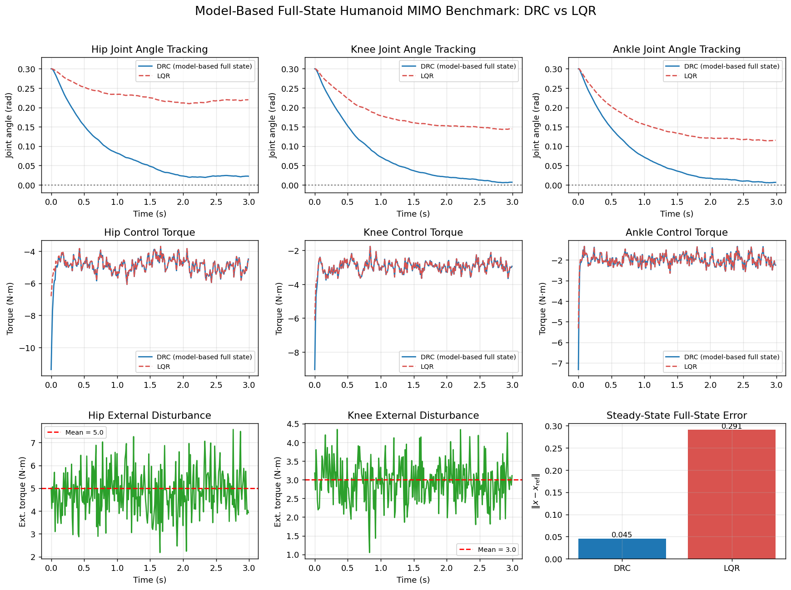
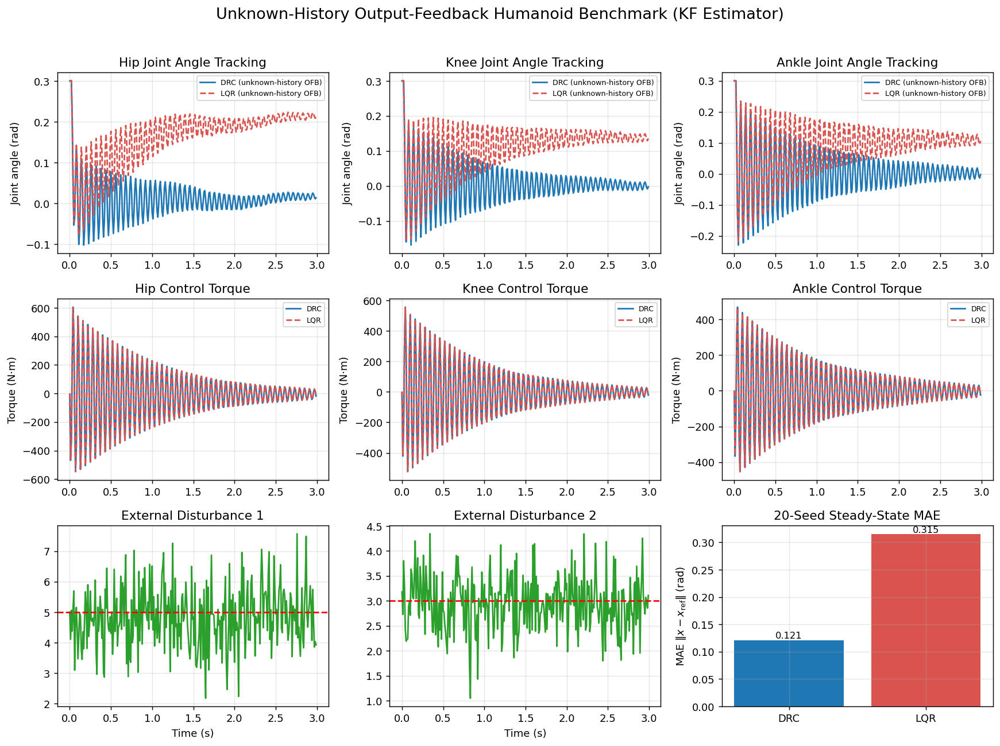
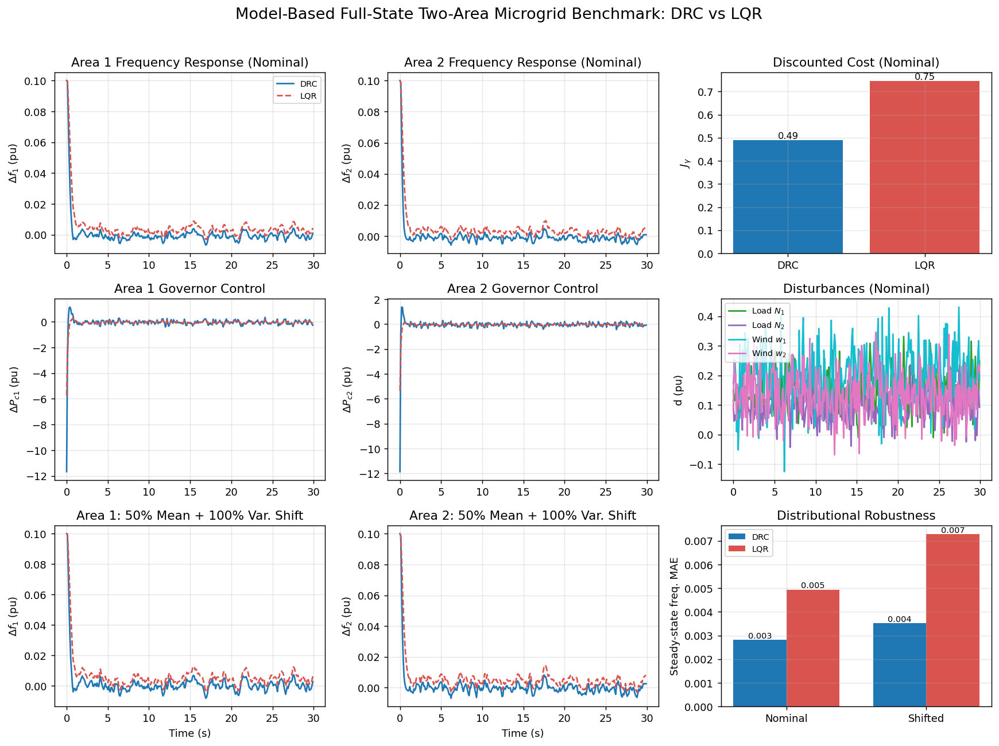
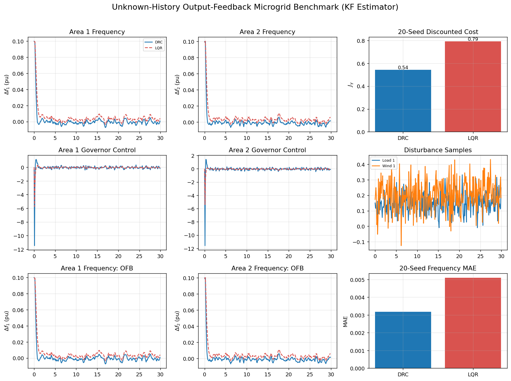

# Wasserstein Distributionally Robust Tracking Control with Non-Zero Worst-Case Mean

## Reproducibility code

This repository contains the simulation code and numerical outputs accompanying the paper
*Wasserstein Distributionally Robust Tracking Control with Non-Zero Worst-Case Mean:
Affine Bias and Data-Driven Policy Iteration*.
Every measured table and figure is generated from the scripts in this folder.
Constants in `models.py` that correspond to published reference values are used
only for regression comparison, never as measured outputs.

## 1. Installation

```bash
python3 -m pip install -r requirements.txt
```

`cvxpy` is used only for the independent Theorem-3 SDP feasibility check.

## 2. Reproduce everything

```bash
cd CAAI_Code_Public
MPLCONFIGDIR=.mplconfig PYTHONDONTWRITEBYTECODE=1 \
  python3 run_complete_suite.py
```

The complete suite regenerates all experiments, figures, logs, the theory
regression tests, and the hard-coded-result scan.  A fast installation check
only is available as

```bash
python3 run_complete_suite.py --quick
```

Quick mode runs the test suites only and must not be used to claim that the
numeric experiments were rerun.

## 3. Experiment map

| Experiment | Table(s) | What is actually tested |
|---|---|---|
| Output-feedback main comparison | `od_e1_main_output_feedback.*` | `y=Cx`, steady-state Kalman observer, no realized disturbance-history input, and `u=K xhat+p`; full-state rows are references only. |
| Output-feedback distribution shift | `od_e2_output_feedback_shift.*` | Same unknown-history observer under humanoid mean shifts and microgrid mean/variance shifts. |
| Output-feedback ablation | `od_e3_output_feedback_ablation.*` | LQR, affine nominal LQR, DRC without bias, and affine DRC under the same observer and seeds. |
| Algorithm 4 end-to-end | `od_e4_algorithm4_end_to_end.*` | Fresh-data identification, IV/2SLS with a designed disturbance probe, SDPI, and post-hoc true-model stability diagnostics; true-model stability is not an update gate. |
| Algorithm 4 rates | `od_e5_algorithm4_rates.*`, `od_e5_algorithm4_rates_points.*` | Fixed-policy finite-sample log-log slopes for the local `O_p(N^-1/2)` statement. |
| Adversary-block rates | `od_e5b_adversary_block_rates.*` | Direct identification rates for `N,z`; weak directions are retained. |
| SDPI diagnostics | `od_e9_sdpi_diagnostics.*` | Scaling-to-original map, policy stationarity, fixed-point residuals, Schur-complement conditioning, and deliberate singular-boundary stops. |
| Identifiability negative control | `od_e10_identifiability_negative.*` | Without exogenous disturbance excitation, full regression rank does not identify `E`; the code reports this instead of fitting a confounded model. |
| Hard Wasserstein scan | `od_e6_hard_wasserstein_own_adversary.*`, `od_e6_lambda_candidate_audit.*` | Outer-`lambda` search, explicit atomwise worst-case distribution, `W2_max <= zeta`, separate DRC/LQR adversaries, and boundary complementary-slackness diagnostics. |
| General-`g` membership | `od_e7_g_w2_membership.*`, `od_e7_g_w2_support_draws.*` | `g=1,2,5,10,20`, ten support draws per controller, outer-`lambda` ball-feasibility checks, and all candidate failures recorded. The separate `e20_g_sample_size` scan extends `g` to 50 with five support draws and two seeds per draw. |
| Nonlinear stress | `od_e8_nonlinear_contact_saturation.*` | Reduced nonlinear humanoid with gravity, friction, contact, saturation, and range diagnostics; reduced nonlinear microgrid with frequency damping, governor saturation, and operating range. DRC/LQR use identical seeds and disturbance paths through an unknown-history output observer. |
| Tail-only stress | `od_e9_tail_only.*` | Gaussian, covariance-matched Student-t (`df=3,5,10`), and covariance-matched tail contamination under the same nonlinear closed-loop setting. |
| Additional robustness | `e18_covariance_only.*`, `e19_heavy_tail.*`, `e20_g_sample_size.*`, `e21_saturation.*` | Model-based sensitivity checks retained for comparison with the main stress suite. |
| Nonzero constant reference | `e22_nonzero_constant_reference.*` | Humanoid affine-bias check with \(x_r\neq0\): compares pure LQR and the nominal bias \(p=B^\dagger((I-A)x_r-E\bar d)\). |
| Initial-gain transition | `e23_initial_gain_transition.*`, `sim_initial_gain_transition.pdf` | Deliberately non-stabilizing humanoid initial policy, scaling/SDPI stabilization trace, and error trajectory after the switch. |

## 4. Results

Every figure and number below is produced by `run_complete_suite.py`; nothing is hand-entered.
The committed `output/` tree (230 files) was regenerated from scratch on a clean copy: 192 files
reproduce byte-identically, and the remaining 38 differ only in run timestamps, wall-clock fields
and last-digit floating-point noise (largest relative deviation 3.4e-8, most differences
1e-12 to 1e-16). Figure canvases differ by 1-2 px, which is tight-bbox rounding under a
different Matplotlib build.

### 4.1 Humanoid MIMO benchmark

| Model-based, full state | Unknown-history output feedback |
|---|---|
|  |  |
| DRC (solid) vs LQR (dashed) on three joints; 20-seed steady-state error `0.045` vs `0.291` rad | Same benchmark through a Kalman observer with `u = K xhat + p`; 20-seed MAE `0.121` vs `0.315` rad |

### 4.2 Microgrid MIMO benchmark

| Model-based, full state | Unknown-history output feedback |
|---|---|
|  |  |
| Two-area frequency deviation and governor control; 20-seed discounted cost | Same benchmark with the observer; 20-seed cost and frequency MAE |

### 4.3 Paper values against measured values (`output/tables/e1_main.md`)

| Metric | measured mean | measured std | paper value | deviation (paper-measured) |
|---|---|---|---|---|
| Humanoid MAE (rad), DRC | 0.0455 | 0.0009 | 0.0455±0.0009 | +0.0000 |
| Humanoid MAE (rad), LQR | 0.2910 | 0.0010 | 0.291±0.001 | +0.0000 |
| Humanoid DRC advantage (%) | 84.4 | — | 84.4 | +0.0 |
| Microgrid discounted cost, DRC | 0.489 | 0.005 | 0.489±0.005 | +0.000 |
| Microgrid discounted cost, LQR | 0.745 | 0.009 | 0.745±0.009 | -0.000 |
| Microgrid freq MAE, DRC | 0.0028 | 0.0000 | 0.0028±0.00003 | -0.0000 |
| Microgrid freq MAE, LQR | 0.0049 | 0.0000 | 0.0049±0.00003 | -0.0000 |
| Microgrid cost advantage (%) | 34.5 | — | 34.5 | +0.0 |

### 4.4 Non-zero constant reference (`output/tables/e22_nonzero_constant_reference.md`)

`x_r = [0.2, 0, 0.3, 0, 0.2, 0]` on the humanoid. Pure LQR keeps a steady-state offset of
`0.2877`; the nominal affine bias `p = B^dagger((I-A)x_r - E dbar)` drives the deterministic
offset to `1.07e-11` while the stochastic MAE drops to `0.0390`.

## 5. Implementation notes

- The affine DRC fixed point is solved by `drc_core.py`. The general-`g`
  objective and its mean-reduction identity are checked in `theory_tests.py`.
- `sdpi.py` checks every scaled candidate on the original system. A candidate
  is never accepted merely because the scaled system is stable. Singular or
  ill-conditioned Schur complements trigger an explicit stop, not a
  pseudo-inverse.
- `algorithm4.py` and `data_driven.py` require an independent disturbance
  channel probe for separate identification of `E` and `N`. With `q=0`, the
  code returns a non-identifiability certificate. True-model trajectories are
  stored only as post-hoc diagnostics and do not reject or filter policies.
- The hard-Wasserstein tables are finite-horizon, sampled-trajectory
  certificates. They do not prove infinite-horizon global Bellman optimality.
- The nonlinear and tail tables are reduced stress tests, not high-fidelity
  hardware simulators.

## 6. Key honest limitations

1. Unknown-disturbance-history output feedback is stable and is benchmarked,
   but it does **not** reproduce the full-state humanoid performance. The
   humanoid OFB DRC MAE is `0.121189` versus full-state `0.045482`.
2. Full `E,N` identification requires the designed probe `q`. Generic
   closed-loop data alone leave `E` confounded with `A+EN`.
3. The IV fixed-policy `N` slopes are not exactly `-1/2` in every case; the
   measured values are reported without clipping.
4. The hard-Wasserstein scan is ball-feasible on sampled trajectories; it is
   not a global hard-Bellman proof. Some microgrid DRC support draws do not
   have an active boundary, so exact KKT complementarity is not claimed there.
5. Humanoid extreme nonlinear stress activates contact and saturation almost
   continuously. Numerical non-divergence over the finite horizon is not a
   hardware-safety claim.
6. The outer Algorithm-4 loop reaches its finite round limit in the reported
   experiments; the paper claim is the local fixed-policy `O_p(N^-1/2)` rate,
   not global outer-loop convergence.

## 7. Verification

```bash
python3 theory_tests.py
python3 algorithm4_tests.py
python3 paper_theory_verification.py
python3 constant_reference.py
python3 initial_gain_transition.py
python3 scan_hardcoded.py
python3 validate_outputs.py
```

The final summaries are:

- `output/FINAL_SUITE_SUMMARY.json`
- `output/FINAL_RESULTS.md`
- `output/HARD_W2_FINAL_REPORT.md`
- `output/od_e8_e9_summary.md`
- `ALGORITHM4_REPORT.md`
- `PAPER_THEORY_VERIFICATION.md`
- `od_e5c_one_step_consistency.md`
- `od_e5d_reconstruction_bound_audit.md`
- `od_e5e_one_step_condition_scan.md`
- `od_e5f_one_step_orthogonal_consistency.md`
- `od_e5g_rigorous_rate_validation.md`
- `THEORY_SIMULATION_SUPPORT_AUDIT.md`
- `SIMULATION_FINDINGS_CN.md` (Chinese reading summary)
